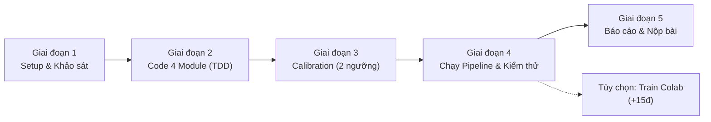

# Kế hoạch triển khai: Day 09 Lab — Auto QC Pipeline

> **Mục tiêu tổng quát**: Xây dựng pipeline kiểm tra và làm sạch nhãn tự động từ lô 224 ảnh thô (`data/raw/`), đảm bảo quy trình tự động hóa với 1 lệnh duy nhất, tích hợp cửa chặn chất lượng (**Release / Hold / Rework**) và có thể truy vết toàn vẹn dữ liệu.

---



---

## Giai đoạn 1: Chuẩn bị môi trường & Khảo sát dữ liệu (~30')
*Mục tiêu: Đưa môi trường về trạng thái sẵn sàng, xác nhận baseline test và quan sát trực quan dữ liệu.*

- [x] **1.1 Khởi tạo môi trường ảo Python & Cài đặt thư viện**
  - Tạo venv `.venv`: `python -m venv .venv`
  - Kích hoạt môi trường và cài đặt: `pip install -r requirements.txt`
  - Cấu hình biến môi trường trên Windows PowerShell: `$env:PYTHONUTF8=1`
- [x] **1.2 Kiểm tra bộ test ban đầu**
  - Chạy `python -m pytest -q`
  - Xác nhận kết quả tiêu chuẩn ban đầu: **55 failed, 24 passed** (ứng với 5 check mẫu đã viết sẵn).
- [x] **1.3 Trực quan hóa và quan sát nhãn thực tế**
  - Chạy `python scripts/viz_labels.py img_0001 img_0030` để render box lên ảnh vào `work/viz/`.
  - Mở xem trực quan ~10 ảnh, ghi lại 3 lỗi nhãn phát hiện bằng mắt (dùng cho Mục 4 của báo cáo).

---

## Giai đoạn 2: Lập trình 4 Module cốt lõi theo TDD (~2 giờ 15')
*Quy trình TDD: Đọc docstring stub $\rightarrow$ Viết code $\rightarrow$ Chạy pytest $\rightarrow$ Sửa đến khi xanh $\rightarrow$ Git commit.*

- [x] **2.1 Module 1 — `pipeline/checks/label_format.py` (Script 2)**
  - Bắt các lỗi định dạng nhãn YOLO:
    - Thiếu/thừa số cột trên dòng.
    - Tọa độ hoặc kích thước box chứa giá trị không hợp lệ (NaN, Inf, chuỗi không phải số).
    - Box diện tích $\le 0$ (`BOX_ZERO_AREA`, `BOX_NEGATIVE`).
    - Box tràn biên ảnh vượt quá dung sai `overflow_tol` (`BOX_OUT_OF_BOUNDS`).
    - ID lớp nằm ngoài danh sách quy định (`UNKNOWN_CLASS`).
  - *Kiểm thử:* `pytest tests/test_label_format.py -q` (14/14 passed)
- [x] **2.2 Module 2 — `pipeline/steps/gate.py` (Cửa chặn chất lượng)**
  - Phân loại trạng thái chất lượng của lô dữ liệu:
    - **`Rework` (mã thoát 20):** Khi còn bất kỳ lỗi nghiêm trọng bắt buộc (`HARD_ERRORS`) chưa được sửa.
    - **`Hold` (mã thoát 10):** Không còn lỗi bắt buộc nhưng tỷ lệ ảnh có cảnh báo chưa duyệt $\ge$ `warn_ratio_hold` (10%).
    - **`Release` (mã thoát 0):** Không còn lỗi bắt buộc và tỷ lệ cảnh báo $< 10\%$.
  - *Kiểm thử:* `pytest tests/test_gate.py -q` (10/10 passed)
- [x] **2.3 Module 3 — `pipeline/steps/autofix.py` (Tự động sửa lỗi)**
  - Tự động khắc phục an toàn các lỗi quy tắc:
    - Kẹp tọa độ box tràn về trong khoảng `[0.0, 1.0]`.
    - Loại bỏ các dòng nhãn có diện tích bằng 0 hoặc bị hỏng nặng.
    - Ghi lại nhật ký thay đổi minh bạch ra `03_fixes.csv` (tuyệt đối không sửa đè `data/raw`).
  - *Kiểm thử:* `pytest tests/test_autofix.py -q` (11/11 passed)
- [x] **2.4 Module 4 — `pipeline/checks/second_opinion.py` (Mô hình làm ý kiến thứ hai)**
  - Đọc cache dự đoán từ `data/cache/checker_preds.json` (mô hình YOLO26l).
  - So sánh IoU và class giữa nhãn người và dự đoán model:
    - Phát hiện cảnh báo sót nhãn (`POSSIBLE_MISSING`).
    - Phát hiện cảnh báo nhầm lớp (`POSSIBLE_WRONG_CLASS`).
    - Phát hiện cảnh báo box vẽ quá lỏng lẻo (`POSSIBLE_LOOSE_BOX`).
    - Phát hiện cảnh báo box thừa không có đối tượng (`POSSIBLE_FALSE_POS`).
  - *Kiểm thử:* `pytest tests/test_second_opinion.py -q` (15/15 passed)
- [x] **2.5 Kiểm tra toàn bộ Test Suite**
  - Chạy `python -m pytest -q` $\rightarrow$ Xác nhận **79 passed (100% xanh)**.

---

## Giai đoạn 3: Hiệu chuẩn ngưỡng (Calibration) (~30')
*Mục tiêu: Dùng 39 ảnh chuẩn có đáp án sẵn tại `data/calib/` để chọn 2 tham số tối ưu.*

- [x] **3.1 Chạy công cụ quét ngưỡng (Sweep)**
  - Chạy `python -m pipeline.calibrate` (hoặc lệnh tương ứng trên Windows).
  - Thu được báo cáo sweep tại `submission/calibration/calibration_report.md` và `.json`.
- [x] **3.2 Phân tích & Chọn 2 ngưỡng tối ưu trong `configs/pipeline.yaml`**
  - Đã hiệu chuẩn `duplicates.phash_dist = 8` (Recall tăng lên 0.67, Precision 1.00).
  - Đã hiệu chuẩn `second_opinion.conf = 0.60` (Recall 1.00 cho missing, Precision wrong_class đạt 0.62).
- [x] **3.3 Kiểm chứng tính hợp lý trên dữ liệu thực (`data/raw/`)**
  - Mở xem trực quan và phát hiện bẫy calibration (phash_dist=16 xóa nhầm img_0011/img_0008).

---

## Giai đoạn 4: Chạy toàn trình Pipeline & Kiểm thử Cửa chặn (~20')
*Mục tiêu: Đảm bảo pipeline chạy tự động trơn tru từ đầu đến cuối và sinh đủ 8 artifact báo cáo.*

- [x] **4.1 Thực thi Pipeline chính thức**
  - Chạy `python -m pipeline.run` (kết luận HOLD, mã thoát 10).
  - Đã sinh đủ 8 file báo cáo tại `submission/reports/` (`01_intake` $\dots$ `08_summary.json`).
  - Đã xuất bản dataset tại `submission/export/clean_v1/` kèm `manifest.json`.
- [x] **4.2 Thực nghiệm kiểm chứng Cửa chặn (Gate Proof)**
  - Chạy thử nghiệm với `--budget 0`:
    ```powershell
    python -m pipeline.run --budget 0 --reports work/rep_nb --export-dir work/exp_nb
    ```
  - Xác nhận gate trả về **Rework**, mã thoát **20**, và **không xuất** dataset do lỗi bắt buộc chưa được người xử lý.
- [ ] **4.3 (Tùy chọn - Chấm riêng 15đ) Huấn luyện trên Colab**
  - Đẩy commit lên GitHub (nhánh `main`).
  - Mở notebook `notebooks/day09_train_compare.ipynb` trên Colab với GPU T4.
  - Chạy train mô hình `yolo26n` (20 epochs, 2 seed) cho cả biến thể `raw` và `clean`.
  - Tải kết quả về đặt vào thư mục `submission/results/`.

---

## Giai đoạn 5: Hoàn tất Báo cáo & Nộp bài (~45')
*Mục tiêu: Lập báo cáo trung thực, đầy đủ bằng chứng số liệu và vượt qua kiểm thử nộp bài.*

- [ ] **5.1 Điền đầy đủ 6 mục trong `submission/REPORT.md`**
  - Mục 1: Kết luận (Release/Hold/Rework) kèm số liệu ảnh vào/ra và lý do chính.
  - Mục 2: Bảng thống kê mã lỗi & Phân việc (máy sửa vs người duyệt).
  - Mục 3: Bảng đối chiếu Calibration (trước $\rightarrow$ sau) & Phân tích điểm mù của calibration.
  - Mục 4: Bằng chứng cửa chặn hoạt động đúng & Tối thiểu 2 điểm mù của pipeline.
  - Mục 5: Kết quả train so sánh (hoặc ghi rõ "chưa chạy" nếu không train).
  - Mục 6: Quyết định cuối cùng & Ghi chú sử dụng AI.
- [ ] **5.2 Hoàn thiện thông tin nhận diện**
  - Cập nhật dòng tiêu đề `README.md` theo định dạng: `# Day 09 Lab — <Họ và tên>: <MSHV> - <Họ và tên>`.
- [ ] **5.3 Kiểm tra tự động trước khi nộp**
  - Chạy script kiểm tra:
    ```powershell
    python scripts/check_submission.py --no-train   # Nếu chưa train Colab
    # hoặc: python scripts/check_submission.py       # Nếu đã có kết quả train
    ```
  - Đảm bảo 0 LỖI.
- [ ] **5.4 Git Commit & Push**
  - Đảm bảo tối thiểu 5 commit có thông điệp rõ ràng mang tên bạn.
  - Kiểm tra không commit các file nhị phân nặng (`work/`, `*.pt`).

---

## Nhiệm vụ cộng điểm thưởng (Tùy chọn)
- [ ] **Bonus +3đ:** Viết thêm 1 Custom Check mới (ví dụ: kiểm tra tỉ lệ khung hình bất thường hoặc mật độ box dày đặc) có unit test kèm theo.
- [ ] **Bonus +2đ:** Thực hành lọc box nhỏ trên giao diện CVAT và viết nhận xét đối chiếu vào Mục 6(b) của báo cáo.

